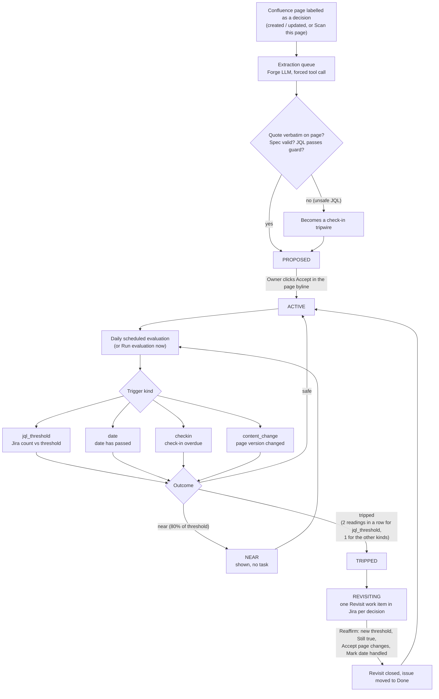
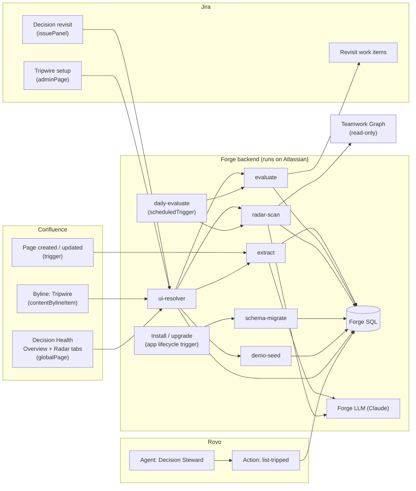
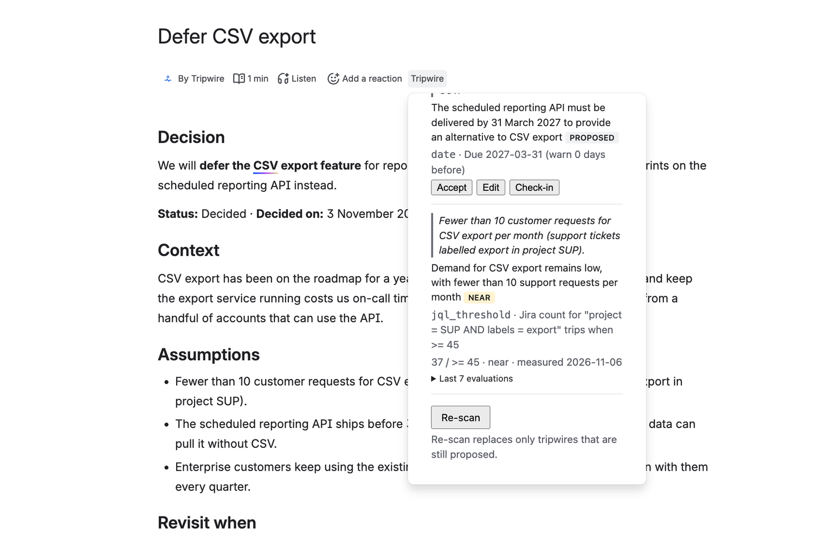
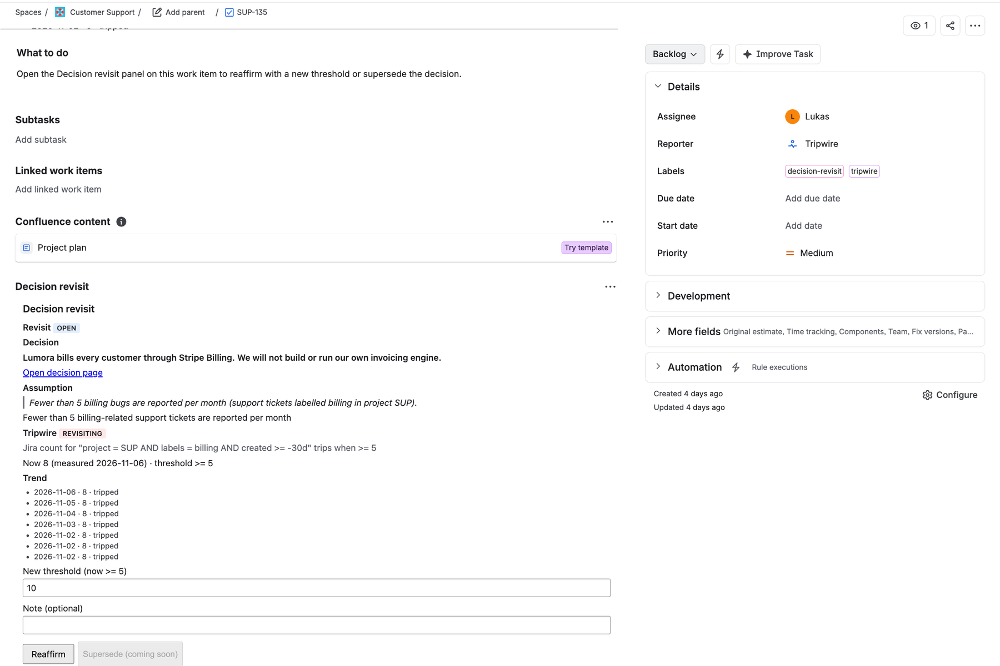
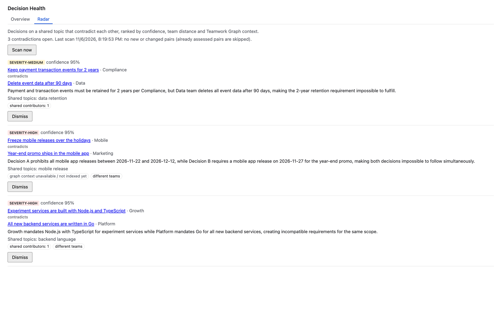
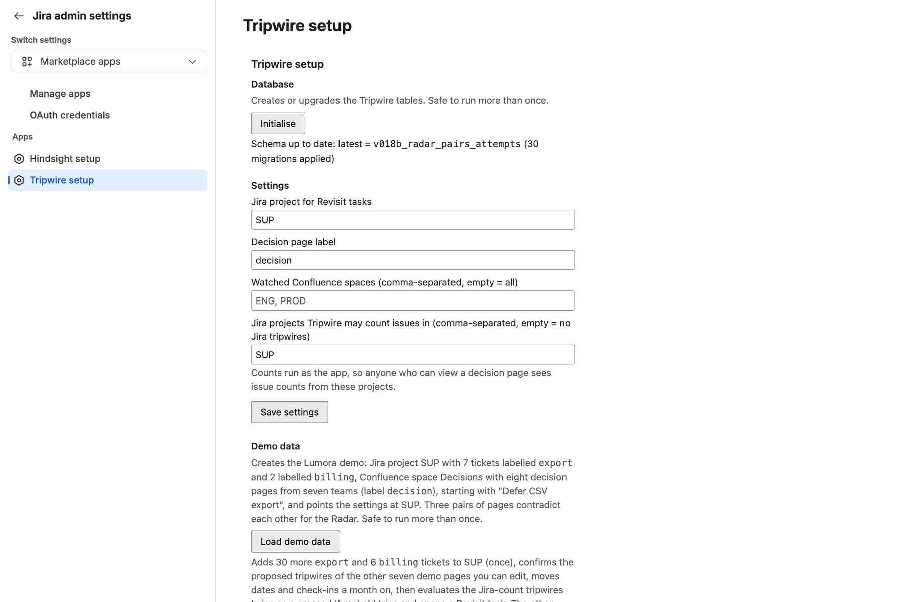
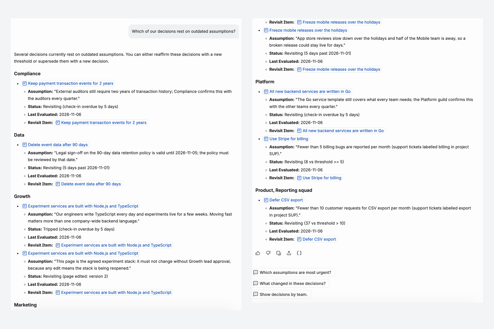

# Tripwire

**Tripwire watches the assumptions behind your team's decisions in Confluence and reopens a decision in Jira when the data says it's no longer true.**


Built for Atlassian Codegeist 2026. Confluence is required, Jira is optional. No data leaves Atlassian.

[](https://youtu.be/r-HCGx84g60)

*Demo video: <https://youtu.be/r-HCGx84g60>*

## Problem → solution

**Problem.** Teams write decisions down, but rarely the conditions under which those decisions stop being right. "We'll defer CSV export because fewer than 10 customers a month ask for it" quietly becomes wrong a few months later, and nobody notices until it hurts. Meanwhile two teams that never talk make opposite calls on the same topic.

**Solution.** Tripwire gives every decision its own expiry conditions, set by data instead of by the calendar:

1. It reads a Confluence decision page and extracts its assumptions with Forge LLM, each backed by a verbatim quote.
2. Each assumption becomes a check (Jira query threshold, date, check-in or page change) that the owner must **Accept**.
3. Checks are evaluated daily with anti-noise rules. When one trips, the owner gets a **Revisit** task in Jira with the evidence.
4. The **Contradiction Radar** flags decisions that contradict each other across teams, and the Rovo agent **Decision Steward** answers "which decisions rest on outdated assumptions?".

## How it works

### Tripwire lifecycle



Statuses match `TripwireStatus` in `src/core/types.ts` (`proposed`, `active`, `near`, `tripped`, `revisiting`, `archived`). `proposed` and `archived` tripwires are never evaluated.

### Architecture



## Features

- **Assumption extraction.** Forge LLM reads a Confluence decision page through a forced tool call and proposes up to 8 tripwires. Page content is passed as data, not as instructions. Every quote is verified against the page text; JQL is checked by a guard (allowlisted fields and functions) and limited to projects the admin has approved. Nothing is watched until the owner clicks **Accept** in the page byline.
- **Trigger kinds**
  - `jql_threshold`: a Jira query count crosses a threshold. Needs two tripped readings in a row (anti-noise) and shows **near** at 80% of the threshold.
  - `date`, `checkin`, `content_change`: trip on the first reading.
- **Revisit tasks.** One Jira work item per decision, idempotent, with the evidence and trend in the *Decision revisit* issue panel. **Reaffirm** re-arms the tripwire (new threshold for numeric checks; *Still true*, *Accept page changes* or *Mark date handled* for the others) and moves the issue to Done. Supersede is not built yet.
- **Contradiction Radar.** The **Decision Health** global page in Confluence (tabs *Overview* and *Radar*) compares decisions on the same topic with Forge LLM and flags pairs that may contradict each other. Severity goes up for decisions from different teams with no shared contributors.
- **Rovo agent "Decision Steward".** Answers "which decisions rest on outdated assumptions?" through the `list-tripped` action, with real data and only for pages the asking user can view.
- **Admin setup in Jira.** Initialise, settings (Revisit project, decision label, watched spaces, Jira projects tripwires may count) and demo buttons (**Load demo data**, **Simulate a busy month**, **Reset demo**) that run as queued jobs with progress on the page.
- **Permission checks.** The user must be able to edit the decision page before Scan, Accept or Reaffirm.
- **Storage.** Decisions, assumptions, tripwires, evaluations, revisits and relations live in Forge SQL.

### Teamwork Graph (read-only)

Tripwire only **reads** Teamwork Graph (Preview), for the Radar: `confluencePageContributors` and `atlassianUserInTeams` via `api.asUser().requestTeamworkGraph`. Only aggregate counts are stored; Tripwire writes nothing to the graph. New pages can take a while to be indexed, so Radar team data for freshly created pages may appear later.

## Screenshots

Real screenshots of Tripwire 3.3.0 running on Atlassian Cloud.

| | |
|---|---|
|  |  |
| **Confluence byline.** Each extracted assumption with its live Jira count against the threshold (37 / ≥ 45, NEAR). | **Decision revisit (Jira).** The decision, the broken assumption, now-vs-threshold evidence and the evaluation trend. |
|  |  |
| **Decision Health Radar.** Contradicting decisions across teams, ranked by severity, with Teamwork Graph context. | **Tripwire setup (Jira admin).** Revisit project, decision label, watched spaces and the Jira projects tripwires may count. |



**Rovo Decision Steward.** Answers "Which of our decisions rest on outdated assumptions?" by team, with each decision's status and reason, e.g. "check-in overdue by 5 days" or "37 vs threshold > 10".

## Install (judges)

Installation link (Confluence + Jira):
https://developer.atlassian.com/console/install/8d1eb26f-a9da-4d4e-81f3-1b2bf96a1726?signature=AYABePh55qyEGpc0%2Fds8A8ogu4MAAAADAAdhd3Mta21zAEthcm46YXdzOmttczp1cy13ZXN0LTI6NzA5NTg3ODM1MjQzOmtleS83MDVlZDY3MC1mNTdjLTQxYjUtOWY5Yi1lM2YyZGNjMTQ2ZTcAuAECAQB4CxqLTo9l4lqXuFjNim1xJM%2Bp%2F3TVP9xHS2BrU5DRRucB821x7TGad46AHAtPDliFjQAAAH4wfAYJKoZIhvcNAQcGoG8wbQIBADBoBgkqhkiG9w0BBwEwHgYJYIZIAWUDBAEuMBEEDLvC5ST3gLEH92lsngIBEIA7cbPU1q98Os1y38UWZN7zkrc1MCmZXpQM41Y0dDYGSQhu%2FUjkXd14IeOnQp09SzzP0avUGDDGvqWNa8cAB2F3cy1rbXMAS2Fybjphd3M6a21zOmV1LXdlc3QtMTo3MDk1ODc4MzUyNDM6a2V5LzQ2MzBjZTZiLTAwYzMtNGRlMi04NzdiLTYyN2UyMDYwZTVjYwC4AQICAHi9bVMAkme4qVQX1fQHo6ePw3H40A7cGfz7yrmSfBWMXgFVg1e0wH18fS53qAGf8iU8AAAAfjB8BgkqhkiG9w0BBwagbzBtAgEAMGgGCSqGSIb3DQEHATAeBglghkgBZQMEAS4wEQQMmo2pAo8MSCrnkSI%2BAgEQgDsWI4r3n1qXSnTtWGVJmJz15MZ%2BLNmG1gdP4P%2BGfq95VJJbZs%2F44WB8x%2F%2BbM51wrnRDS3FsOvkNtCfstwAHYXdzLWttcwBLYXJuOmF3czprbXM6dXMtZWFzdC0xOjcwOTU4NzgzNTI0MzprZXkvNmMxMjBiYTAtNGNkNS00OTg1LWI4MmUtNDBhMDQ5NTJjYzU3ALgBAgIAeDYASx0XCjkny4iLV6vz%2BKtEGSGT6kdt0QRpkn6D%2FlVEAbJjkaSsnPr1PTXtQd95ln0AAAB%2BMHwGCSqGSIb3DQEHBqBvMG0CAQAwaAYJKoZIhvcNAQcBMB4GCWCGSAFlAwQBLjARBAxnoRQiFh%2BL9NrL7P4CARCAO6F%2BpoBFH2j3v7u4grdBUh7%2B1VEZN27Nh8IpgNOclYHEuXd%2Bkgqmb4RYPgTJmsbLmqkqbVGn%2BvnvSCHrAgAAAAAMAAAQAAAAAAAAAAAAAAAAAGZ8cXyI87SIFpu6R9BDndf%2F%2F%2F%2F%2FAAAAAQAAAAAAAAAAAAAAAQAAADLebku2wJgkhNhUZxuTszZOfoyl6nr%2FOkoVeMbKY3wgBk75gUCu%2FBRkwtkNE%2BBSdhZS59vcROKYMp25NoBIHIdtoUY%3D&product=confluence&product=jira

Installing requires an organization admin, because Tripwire reads Teamwork Graph.

1. Open the link above and install Tripwire on your site (Confluence and Jira).
2. In Jira, go to **Settings → Apps → Tripwire setup**.
3. Click **Initialise** (a new install sets up its database in a minute or two; the page shows the progress).
4. Click **Load demo data** and wait until the page shows the result (one click; progress is shown while it runs). Keep the page open a moment: it then adds "Reviewed by <you>." to the demo pages as you, so the Radar can show Teamwork Graph contributors.
5. In Confluence, open the page **Defer CSV export** in the **Decisions (DEC)** space and click **Accept** on its tripwire.
6. Back in Tripwire setup, click **Simulate a busy month** and wait for the result, e.g. "Revisit: SUP-12".
7. Open that Revisit issue in the **SUP** project to see why the decision should be reopened, then click **Reaffirm** on an assumption to re-arm it.
8. In Confluence, open **Decision Health** (Apps menu) and switch to the **Radar** tab to see contradicting decisions.
9. Ask Rovo agent **Decision Steward**: "Which of our decisions rest on outdated assumptions?"

To start over, use **Reset demo** in Tripwire setup.

## Permissions and privacy

Tripwire runs entirely on Atlassian Forge. The manifest declares no external fetch or remote, so no data leaves Atlassian. Extraction and the Radar use Forge LLM (Claude hosted by Atlassian). Data is stored per installation in Forge SQL; the only personal data stored is Atlassian account IDs.

| Scope | Why |
|---|---|
| `read:confluence-content.all`, `read:confluence-content.summary`, `read:page:confluence` | Read decision pages and page created/updated events |
| `read:label:confluence`, `read:space:confluence` | Find pages with the decision label in watched spaces |
| `write:confluence-content`, `write:page:confluence`, `write:confluence-space` | Create the demo space and pages, and edit only those demo pages (Load, Simulate, Reset); your own pages are never changed |
| `read:jira-work`, `write:jira-work` | Evaluate JQL thresholds; create, comment on and transition Revisit work items |
| `manage:jira-project`, `manage:jira-configuration` | Revisit project setup, admin check, issue types for Revisit tasks |
| `read:graph:issue:jira`, `read:graph:project:jira`, `read:graph:user:atlassian`, `read:graph:page:confluence`, `read:graph:team:atlassian` | Teamwork Graph, read-only (Radar team context) |

Details: [Privacy policy](docs/PRIVACY.md) · [Terms of service](docs/TERMS.md)

## Development

Prerequisites: Node.js 22 or later, the [Forge CLI](https://developer.atlassian.com/platform/forge/getting-started/) logged in, and an Atlassian Cloud site with Confluence (and optionally Jira).

```sh
npm install
npm run build          # typecheck + build Custom UI into static/*/build
npm test               # vitest
forge lint
forge deploy -e development
forge install --site <site>.atlassian.net --product confluence -e development
forge install --site <site>.atlassian.net --product jira -e development
```

### Layout

```text
manifest.yml       Forge modules, queues, scopes
src/core/          domain model, state machine, trigger kinds (validate / evaluate), Forge SQL migrations
src/core/triggers/ jql_threshold, date, checkin, content_change (+ graph_relation, designed but not evaluated yet)
src/llm/           Forge LLM wrapper, extraction and radar prompts
src/adapters/      Confluence, Jira, Teamwork Graph, Forge SQL
src/surfaces/      UI resolver, Rovo action, event triggers and queue consumers
ui/                Custom UI sources (byline, health, revisit, setup), built into static/
prompts/           Rovo agent prompt
test/              vitest suites
docs/              privacy policy, terms, screenshots
```

## License

[MIT](LICENSE)
